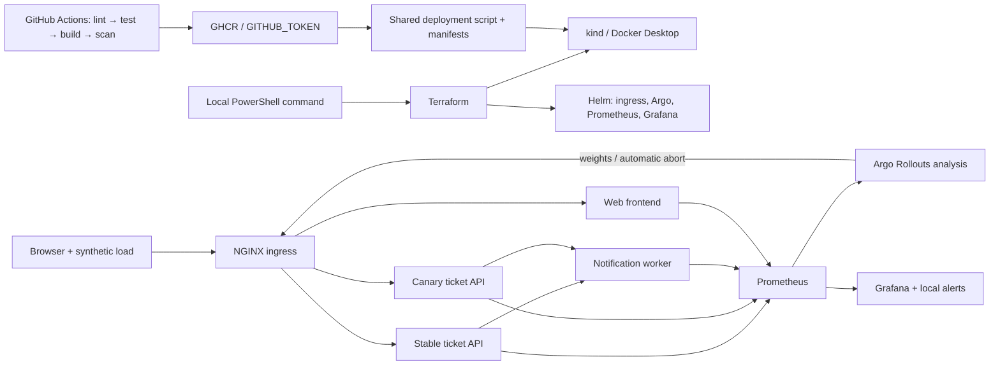
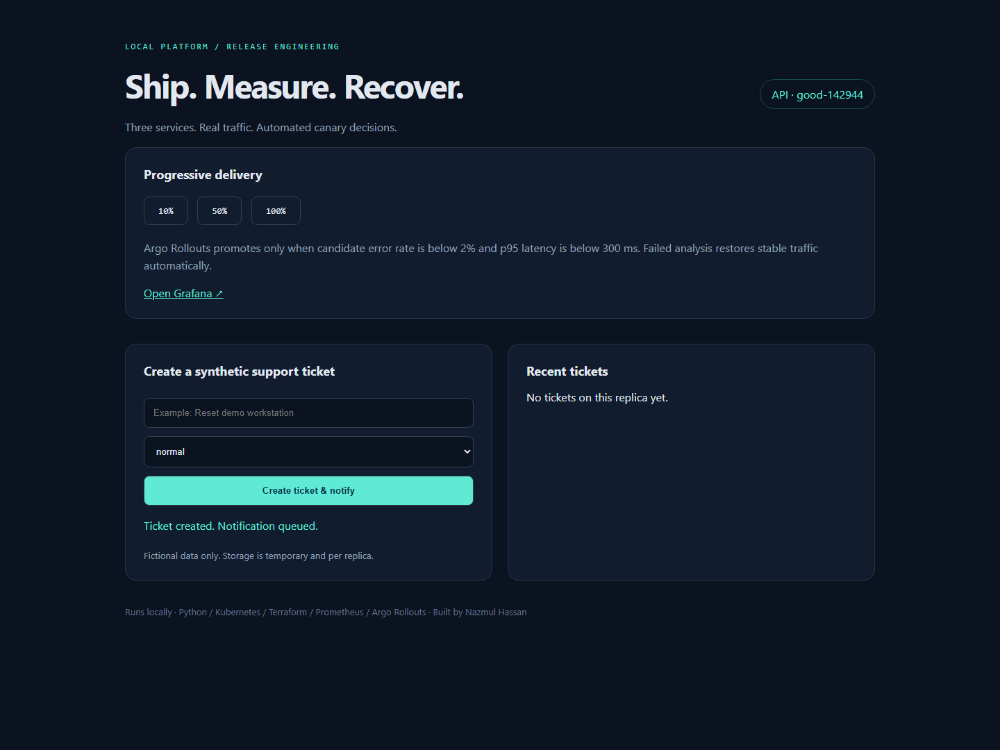
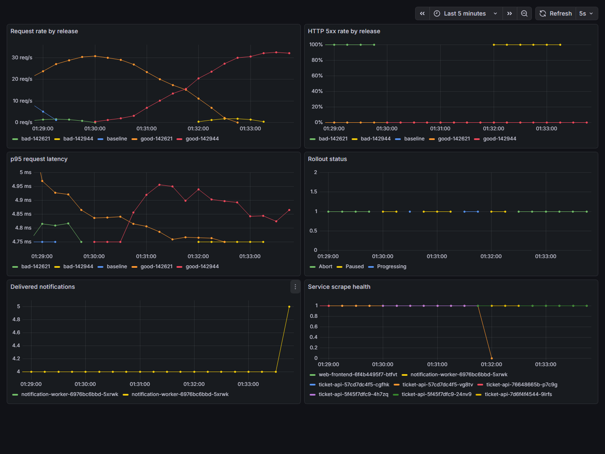
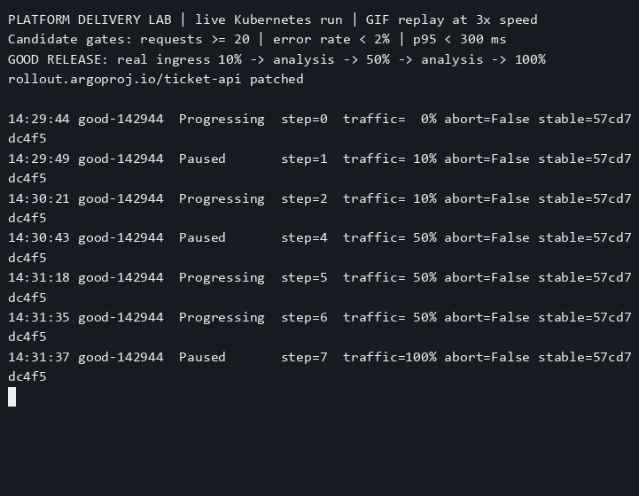
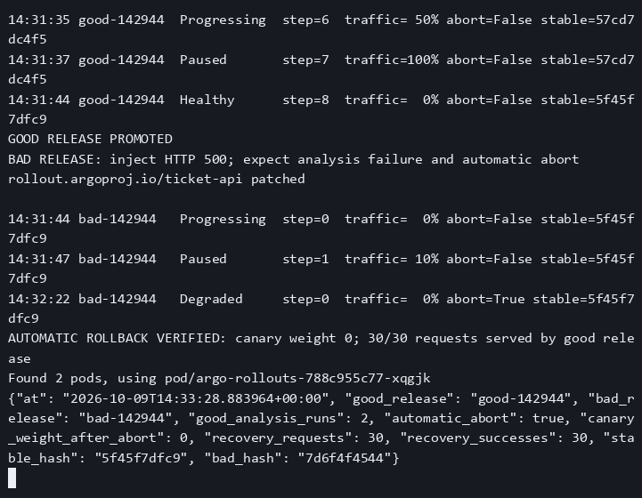
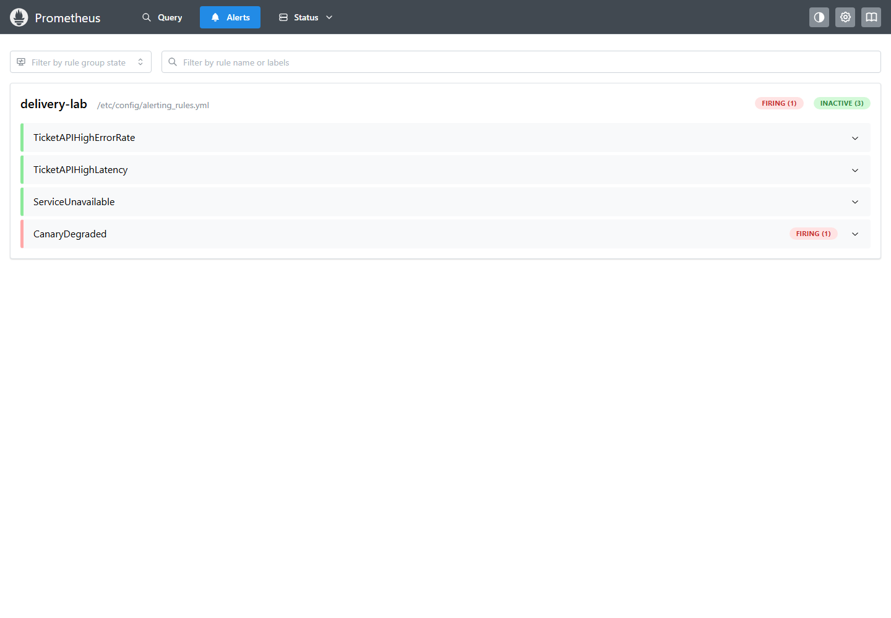

Ship three containerised services through a local Kubernetes canary pipeline that measures health and automatically restores stable traffic.


[](https://github.com/iamnajib71/platform-delivery-lab/actions/workflows/ci.yml)
[](LICENSE)


**Runs locally.** No paid cloud account, public cluster, external credentials, or hosted backend.
The GIF records the actual rollout command with asciinema and agg; playback is accelerated 3×.

## What it shows recruiters

- **Junior DevOps / platform engineering:** Terraform provisions kind and Helm releases; CI tests, builds, scans, publishes images, deploys, and smoke-tests the same manifests used locally.
- **Cloud support / operations:** structured request logs, health probes, Prometheus metrics, Grafana panels, alert rules, and an [incident runbook](ops/runbook.md).
- **Release coordination:** real ingress traffic moves through 10% → 50% → 100%; candidate-specific error and latency gates reject a faulty release and restore stable traffic without manual promotion or rollback.

## Architecture



The web frontend serves a real ticket form. The API validates requests and queues a notification;
the worker consumes an in-process queue, deduplicates event IDs, and logs fictional delivery.
No email, SMS, or external message is sent.

## Screenshots







## Quick start — Windows

Prerequisites: Windows 11, **PowerShell 7**, Git, Python 3.12–3.14, and running Docker Desktop
with Linux containers. Allocate at least 8 GB of Docker memory. Ports **8088, 3008, 9098**
must be free. Downloads require internet access; runtime needs no cloud account.
Terraform 1.13.5, kind 0.33.0, and Helm 3.17.3 are downloaded into `.tools/` with SHA-256 checks.

```powershell
git clone https://github.com/iamnajib71/platform-delivery-lab.git
cd platform-delivery-lab
pwsh -NoProfile -File scripts/lab.ps1 up
```

That one command runs lint and tests, plans and applies Terraform, builds and scans the three images,
generates SBOMs, loads images into kind, deploys, smoke-tests the ticket-to-worker path, and demonstrates a healthy
release followed by a faulty release that Argo aborts automatically. Evidence goes into
`artifacts/demo/`. Allow several minutes on the first run for image and chart downloads.

Open the [ticket console](http://localhost:8088), [Grafana](http://localhost:3008/d/lab/platform-delivery-lab),
and [Prometheus alerts](http://localhost:9098/alerts). Grafana permits anonymous **Viewer** access
only on the loopback-bound local port. The final Rollout is deliberately Degraded: the bad
candidate was rejected, while stable requests continue returning HTTP 200.

```powershell
# Unit/contract tests without a cluster
pwsh -NoProfile -File scripts/lab.ps1 test

# Repeat both release scenarios on an existing lab
pwsh -NoProfile -File scripts/lab.ps1 demo

# Trivy gate + SPDX SBOMs (requires the local images built by 'up')
pwsh -NoProfile -File scripts/scan.ps1

# Destroy the Terraform-managed platform and cluster
pwsh -NoProfile -File scripts/lab.ps1 down
```

### Terraform directly

```powershell
./scripts/bootstrap.ps1
New-Item -ItemType Directory -Force .kube | Out-Null
terraform -chdir=infra init
terraform -chdir=infra plan
terraform -chdir=infra apply
terraform -chdir=infra destroy
```

The provider lock file is committed. State and kubeconfig are ignored because they contain
local cluster credentials. **Local state is intentional:** one operator owns a disposable
Docker cluster, and CI uses a fresh runner. There is no shared environment requiring a remote
backend or distributed state lock. Keep your local state until `destroy` completes.

### CI delivery

The [workflow](.github/workflows/ci.yml) executes lint → unit/contract tests → Terraform validation
→ build → Trivy gate → Syft SBOM → GHCR push → Terraform/kind deploy → smoke tests → rollout
demo → diagnostics → destroy. PRs exercise the same pipeline without registry login or push.
The built-in `GITHUB_TOKEN` supplies package write permission on trusted pushes; no stored secret
is required. CI uses SHA image tags and loads the exact scanned local images into kind.

Trivy fails on **fixable HIGH/CRITICAL** vulnerabilities. Unfixed issues and lower severities
are outside that gate; a passing scan does not mean an image is vulnerability-free. JSON scan
reports and SPDX SBOMs are uploaded with the delivery evidence.

## Results and real evidence

| Check | Actual result | Evidence |
|---|---|---|
| Unit / contract tests | 12 passed; 0 failures; 0.84s | [JUnit](docs/evidence/tests.xml) |
| Healthy candidate | 10% → 50% → 100%; two successful analyses | [Recorded run](docs/demo.gif) |
| Good candidate p95 | 4.75–4.93 ms across six gate samples | [Measurements](docs/evidence/results.json) |
| Faulty candidate | 100% candidate errors; analysis failed; canary returned to 0% | [AnalysisRun](docs/evidence/demo/bad-142944-analysis.json) |
| Stable recovery | 30/30 HTTP 200 from the good release | [Summary](docs/evidence/demo/summary.json) |
| Service image scan / SBOM | 0 fixable HIGH/CRITICAL per image; 131 SPDX packages each | [Raw reports](docs/evidence/README.md) |
| Recorded demo | 83.59 seconds at 3× playback | [Recording method](docs/recording.md) |
| Fresh Windows checkout | 5 Terraform resources created; tests, scans, smoke, rollout and firing alert passed | [Full run](docs/evidence/windows-clean-clone/run.log) |

Measured results and source files are listed in [docs/evidence/README.md](docs/evidence/README.md).
The demo asserts two successful analysis runs for the good candidate, a failed error-rate
analysis for the injected candidate, zero canary traffic after abort, and **30/30 stable HTTP 200
responses** after recovery, plus a firing `CanaryDegraded` alert. Raw controller logs, Kubernetes events, AnalysisRuns, Rollouts, and
timestamped timelines are preserved; no metrics or run outputs are fabricated.

Candidate gates use the latest pod hash, rather than a fleet-wide average that could hide a
bad 10% canary. Each stage warms for 35s, then samples three times 10s apart:

| Gate | Required result | Missing/invalid data |
|---|---|---|
| Requests in the last 30s | ≥20 | Fails at 0 |
| Candidate HTTP 5xx ratio | <2% | Empty, NaN, infinity fail |
| Candidate p95 latency | <300ms | Empty, NaN, infinity fail |

Failure causes Argo to abort and set ingress weight to zero. The good ReplicaSet remains
stable. The faulty desired template stays visible for investigation: automatic **traffic
rollback** does not revert Git. See the [runbook](ops/runbook.md) to restore desired state.

## Project structure

```text
.github/workflows/ci.yml   Lint, tests, images, scans, GHCR, kind smoke/demo
services/                 Ticket API, notification worker, web frontend
tests/                    Service unit and cross-service contract tests
Dockerfile                Parameterised multi-stage, non-root service image
infra/                    Terraform + pinned Helm releases and values
k8s/                      Shared services, ingress, canary, analysis, deployments
ops/                      Provisioned dashboard and incident runbook
scripts/                  Windows quick start, deploy, load, smoke, demo, scans
docs/                     Recorded GIF, actual screenshots, raw evidence, preview
```

## Honest limits

- This is a single-node local lab, **not production**: no HA, TLS, authentication, persistent
  business storage, durable broker, disaster recovery, network policies, or autoscaling.
- Tickets are in memory **per API replica**; refreshes can show different ticket lists. Worker
  deduplication and queue state are temporary and capped at 1,000 events. Restart clears them.
- The bad release is an explicit `INJECT_ERROR=true` switch on the real API pod template;
  readiness stays healthy so Prometheus analysis, rather than a probe failure, rejects it.
- Synthetic traffic is approximately 30 requests/second. The short analysis windows teach the
  mechanics; they are not statistically sufficient production release criteria.
- Alert rules are evaluated locally without an external pager. Container scans cover the
  three service images; Helm-managed infrastructure images are outside the service scan gate.
- NGINX ingress is retained here for the documented Argo traffic-routing integration. Before
  production use, reassess its upstream maintenance/security status and use a supported ingress
  or Gateway API implementation.
- CI runners, registry pulls, and public GHCR storage are subject to free-tier availability
  and rate limits. Re-running infrastructure costs no cloud credits but uses local CPU/RAM.

## Built by Nazmul Hassan

[LinkedIn](https://linkedin.com/in/iamnajib71) · [GitHub](https://github.com/iamnajib71)

MIT licensed. Social preview: [docs/social-preview.png](docs/social-preview.png), 1280×640;
upload it in GitHub Settings → General → Social preview.
